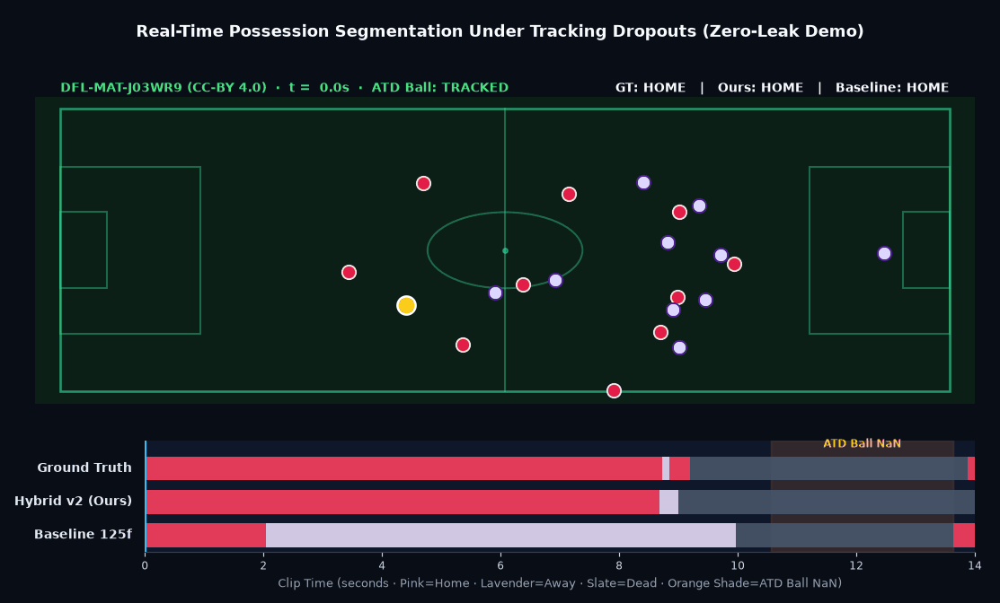
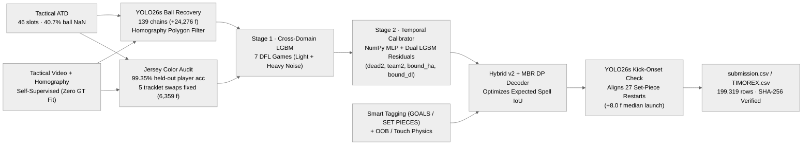
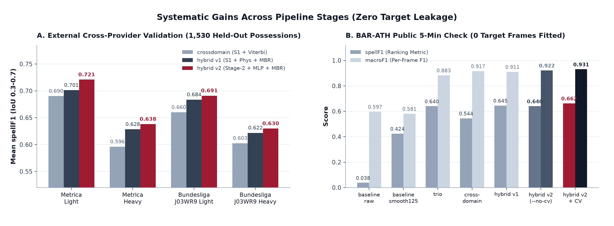

<div align="center">

<a href="TECHNICAL_REPORT.md">
  
</a>

<p>
  <b>Team TIMOREX</b> · Branch <code>hybrid</code> · <b><a href="TECHNICAL_REPORT.md">Technical Report</a></b> ·
  <a href="#reproduction">Reproduction (SHA-256)</a> ·
  <a href="#pipeline">Pipeline</a> ·
  <a href="#validation">Validation</a> ·
  <a href="#computer-vision-diagnostics">CV Diagnostics</a> ·
  <a href="#external-data-and-compliance">Data &amp; Compliance</a>
</p>



<sub>
  Held-out Bundesliga tracking (<code>DFL-MAT-J03WR9</code>, <b>CC-BY 4.0</b>; zero <code>BAR-ATH</code> video frames) under simulated ATD drift and shaded <code>ATD Ball NaN</code> dropouts. Clip accuracy: <b>93.1%</b> (<code>Hybrid v2</code>) vs <b>10.9%</b> (<code>125f</code> nearest-player baseline).
</sub>

</div>

---

## Overview

**Goal:** Assign `H` (Home), `A` (Away), `D` (Dead ball), or `X` (Out of half) to all **199,319 frames (25 Hz)** of **FC Barcelona vs Athletic Club** (LaLiga 2024–25, MD2). Submissions are ranked by interval-level **`spellF1`** (mean match F1 across IoU `0.3`–`0.7`), with per-frame **`macroF1`** as tie-breaker.

Because raw automatic tracking omits the ball on **40.7%** of graded frames (median gap **268 frames**) and suffers occasional slot identity swaps, nearest-player heuristics fracture continuous possessions or mislabel stoppages. Every learned model weight in this repository is fit solely on external open datasets (`DFL` IDSSE and `Metrica` sample games) and Roboflow `football_tactical` v4, with zero fitting on `BAR-ATH` public labels.

| Metric | Best Official Baseline (`smooth125`) | Submitted (`hybrid v2 + CV`) |
|---|---:|---:|
| **Public 5-Min `spellF1` (17 GT possessions)** | `0.4242` (`16` spells, `18.5 s` mean) | **`0.6625`** (`15` spells, `16.4 s` mean) |
| **Public 5-Min `macroF1` (`H / A / D`)** | `0.5812` | **`0.9306`** (`0.9366 / 0.9428 / 0.9123`) |
| **Public 5-Min `transF1 @25f` & Team Acc** | `0.1667` · `88.54%` | **`0.5946`** · **`95.87%`** |
| **BAR-ATH Graded Ball Missingness (`ball = NaN`)** | `40.7%` (`med gap 268 f`) | **`25.4%`** (`+24,276 f` recovered · `med gap 34 f`) |
| **Target Ground-Truth Frames Used in Fit** | `0` | **`0`** |

Full experimental details and negative results are recorded in **[TECHNICAL_REPORT.md](TECHNICAL_REPORT.md)**.

---

## Pipeline



<details>
<summary><b>Stage descriptions</b></summary>

1. **Correlated Noise Simulation & Stage 1 (`src/degrade.py`, `src/train.py`):** 7 official `DFL` Bundesliga matches are degraded with slot swaps, tracklet fragmentation, and long ball-NaN blocks matched to `BAR-ATH` ATD statistics. Stage 1 trains a ball-blind `dead_head` and a symmetric `team_head`.
2. **Stage-2 Temporal Calibration (`src/stage2.py`, `src/train_stage2.py`):** Refines Stage-1 logits with bidirectional multi-scale windows (`dead2`, `team2`, symmetric boundary heads `bound_ha`/`bound_dl`) and a pure-NumPy `(64, 32)` MLP (`w_mlp = 0.25`) calibrated via 3-fold Nested LOGO CV on Metrica.
3. **Domain-Adapted Tiny-Ball Detector (`src/cv_ball_data.py`, `src/cv_train_ball.py`):** [`YOLO26s`](models/ball_yolo26s_stage_b.pt) is trained on Roboflow `football-tactical` v4 (`CC BY 4.0`, `mAP50 = 0.9575`) and adapted (`Stage-B`) using strictly out-of-window (`frame > 19,000`) 3-frame collinear ATD-agreed detections plus replay (`mAP50 = 0.9618` external test; `0.9950` on held-out `BAR-ATH` tiles `172k–190k`).
4. **DAG Ball Recovery & Jersey Audit (`src/cv_recover_ball.py`, `src/cv_jersey.py`):** Two-pass deterministic GPU inference fills `139` chains (`+24,276` frames including `1,508` edge/OOB frames, reducing `ball = NaN` from `40.7%` to `25.4%`). An illumination-invariant `(L - L_bg, V - V_bg)` upper-torso audit trained on isolated `frame > 19,000` tracks achieves `99.35%` accuracy on `frame <= 19,000`, verifying `99.74%` of `2,840,921` player-frames and correcting `5` swapped tracklets (`6,359` frames).
5. **MBR Decoding & Kick-Onset Snap (`src/mbr_decoder.py`, `src/smart_priors.py`, `src/cv_boundary_motion.py`):** Decodes half sequences against expected `spellF1` under `oob`/`live_in`/touch cues and `SET PIECES`/`GOALS` anchors, then shifts `27` clean ground set-piece starts onto physical `YOLO26s` ball displacement.

</details>

---

## Validation

Across **1,530 held-out possessions** on **Metrica Sample Data** (Nested LOGO CV) and held-out **Bundesliga `DFL-MAT-J03WR9`**, every pipeline upgrade improves interval recovery consistently before touching any competition frame:

<div align="center">
  
</div>

| Variant | Target GT Fit | Public `macroF1` | Public `spellF1` | IoU `0.5 / 0.7` | Poss (`GT=17`) | TransF1 `@12 / @25` | Mean Latency | Team Acc (Both Alive) |
|---|---:|---:|---:|---:|---:|---:|---:|---:|
| **`hybrid v2 + CV` (Submitted)** | **0** | **`0.9306`** | **`0.6625`** | `0.625 /` **`0.563`** | **`15`** (`16.4 s`) | `0.3784 /` **`0.5946`** | `-1.9 f` | **`95.87%`** |
| `hybrid v2` (`--no-cv`, raw ATD) | 0 | `0.9216` | `0.6400` | **`0.667`** `/ 0.533` | `13` (`19.0 s`) | **`0.5143`** `/ 0.5714` | **`-0.7 f`** | `94.43%` |
| `hybrid v1` | 0 | `0.9110` | `0.6452` | `0.645 / 0.516` | `14` | `0.4865 / 0.5405` | `-0.6 f` | `94.67%` |
| `crossdomain` | 0 | `0.9167` | `0.5444` | `0.500 / 0.444` | `19` | `— / 0.5581` | `+1.4 f` | `94.52%` |
| `trio` | 0 | `0.8834` | `0.6400` | `0.733 / 0.467` | `13` | `0.2778 / 0.4444` | `-6.9 f` | `92.04%` |
| `baseline_smooth125` | 0 | `0.5812` | `0.4242` | `0.424 / 0.242` | `16` (`18.5 s`) | `0.1111 / 0.1667` | `-7.7 f` | `88.54%` |

---

## Computer Vision Diagnostics

<div align="center">
  
</div>

- **Full-Match Unlabelled Consistency (`158,857` graded frames, `282` spells):** Live possession settles at **61.71% FC Barcelona / 38.29% Athletic Club** (`Half 1: 66.51% / 33.49%`, `Half 2: 56.78% / 43.22%`, `Dead ball D: 48.4%`), with **`4 / 4`** Goal celebrations classified `97.7%–100.0%` dead and post-kickoffs matching scoring order (`A, H, H, A`), **`51 / 53`** pre-Set-Piece dead windows, and **`52 / 52`** Set-Piece team alignments.

---

## Reproduction

All Stage-1, Stage-2, and YOLO26s weights ship inside [`models/`](models/) (`28.15 MB` total; no Git LFS required). Inference produces a bit-identical CSV:

```powershell
# 1. Install pinned dependencies
pip install -r requirements-pipeline.txt

# 2. Unpack enrolled BAR-ATH bundle under ./data (or set MTAH_DATA_DIR)
# 3. Generate the final submission (~37s with CV caches; first run builds CV caches from tactical .mp4)
python src/run_pipeline.py --out evaluation/results/submission.csv

# 4. Validate schema & score public 5-minute window
python evaluation/validate_submission.py evaluation/results/submission.csv
python evaluation/run_evaluation.py --gt public
```

```powershell
# 5. Verify SHA-256 checksum
# Windows (PowerShell):
(Get-FileHash evaluation/results/submission.csv -Algorithm SHA256).Hash.ToLower()
# Linux / macOS (Bash):
sha256sum evaluation/results/submission.csv
```

Expected checksum:

```text
93e9cba65fd636da5be4ff8693517b91f678ba1fc7cd15af93da98b2e31ad39f
```

> Add `--no-cv` for fast (`~18 s`) CPU-only Phase-1 `Hybrid v2` inference on raw ATD, or `--rebuild-cv` to recompute CV caches from raw tactical video. Training reproduction steps are in [`TECHNICAL_REPORT.md`](TECHNICAL_REPORT.md#9-reproduction).

---

## External Data and Compliance

| Dataset | Use | License / Source |
|---|---|---|
| **DFL Bundesliga Open Data (IDSSE)** | Stage-1 & Stage-2 training (`7` games) + held-out validation (`DFL-MAT-J03WR9`) | [Bassek et al. 2025, *Scientific Data* 12:195 (`CC-BY 4.0`)](https://doi.org/10.1038/s41597-025-04505-y) |
| **Metrica Sports Sample Data** | External Nested LOGO CV (`3` games) | [metrica-sports/sample-data](https://github.com/metrica-sports/sample-data) |
| **Roboflow `football_tactical` v4** | Stage-A `YOLO26s` ball detector training (`640x640`, `class 0 = ball`) | [Alfonso Secretará Técnica (`CC BY 4.0`)](https://universe.roboflow.com/alfonso-secretara-tcnica/football-tactical) |

- **Repository Hygiene:** `git ls-files` contains zero `.mp4`, `_atd.txt`, `_atd.xml`, `_smart_tagging.xml`, `_homography.csv`, or real match screenshots.
- **Zero Public-GT Fitting:** Public `evaluation/gt/BAR-ATH_possession_gt_public.csv` frames (`0..19,000`) are excluded from all training and tuning splits.

---

<details>
<summary><b>Repository Layout</b></summary>

```text
TECHNICAL_REPORT.md          Methodological documentation, ablations, and reproduction guide
requirements-pipeline.txt    Pinned Python / Torch / Ultralytics / LightGBM inference dependencies
models/                      Trained checkpoints (28.15 MB total, < 100 MB, no Git LFS)
  ball_yolo26s_stage_b.pt    Domain-adapted YOLO26s ball detector (19.4 MiB)
  dead_head.txt, team_head.txt, bound_dl.txt, bound_ha.txt    Stage-1 LGBM ensemble
  stage2_mlp.npz, dead2.txt, team2.txt, *_meta.json           Stage-2 calibrators
src/
  run_pipeline.py            End-to-end deterministic inference CLI
  cv_ball_data.py            Stage-A tiling & Stage-B 3-frame collinear mining
  cv_train_ball.py           Deterministic YOLO26s training script (--stage A|B)
  cv_recover_ball.py         Two-pass homography-gated YOLO26s + DAG ball recovery
  cv_jersey.py               Illumination-invariant tracklet swap detector
  cv_boundary_motion.py      Unsmoothed YOLO26s kick-onset alignment at D -> Live boundaries
  cv_integration.py          CV artifact loader and integration hooks
  stage2.py / train_stage2.py    Noisy-Bundesliga temporal calibrator
  smart_priors.py / mbr_decoder.py    Physical/Smart-Tag priors and soft-IoU MBR decoder
  train.py / features.py / degrade.py / validate_external.py    External DFL/Metrica tooling
docs/assets/                 Banner SVG, DFL held-out radar GIF, and validation charts
evaluation/                  Official scorer, validator, and baseline outputs
```

</details>

<details id="challenge-reference">
<summary><b>Official Challenge Reference (More than a Hack 2027)</b></summary>

**Organised by [Metrica Sports](https://metrica-sports.com), [FC Barcelona](https://www.fcbarcelona.com), and the [Mobile World Capital Barcelona](https://www.mwcbarcelona.com)**, at the Talent Arena in Barcelona.

| Document | Contents |
|---|---|
| **[CHALLENGE.md](CHALLENGE.md)** | Problem statement, four possession labels (`H` / `A` / `D` / `X`), definitions |
| **[DATA.md](DATA.md)** | Match bundle schemas and frame alignment |
| **[EVALUATION.md](EVALUATION.md)** | Metric definitions (`spellF1`, `macroF1`, transition latency) |
| **[SUBMISSION.md](SUBMISSION.md)** | File contract and submission form deliverables |
| **[RULES.md](RULES.md)** | Allowed external data and anti-leakage rules |
| **[FAQ.md](FAQ.md)** · **[OVERVIEW.md](OVERVIEW.md)** | Clarifications, second-half pre-kickoff rule, competition context |

Run official baselines without match data:

```bash
pip install -r requirements.txt
python evaluation/run_evaluation.py
```

Enrolment: **[More than a Hack 2027](https://landing.mobileworldcapital.com/more-than-a-hack-2027)** · Contact: **hackathon.talentarena@mobileworldcapital.com**. Code & docs: MIT ([LICENSE](LICENSE)); match data remains under tournament licence and is never committed.

```bibtex
@misc{mtah2027,
  title  = {More than a Hack 2027: Phase 1 - Ball Possession},
  author = {Metrica Sports and FC Barcelona Innovation Hub},
  year   = {2027},
  url    = {https://github.com/metrica-sports/more-than-a-hack-2027}
}
```

</details>
