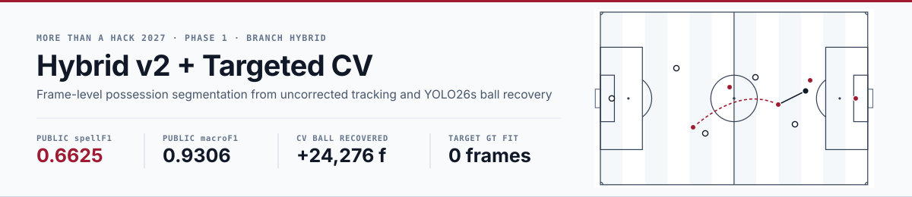
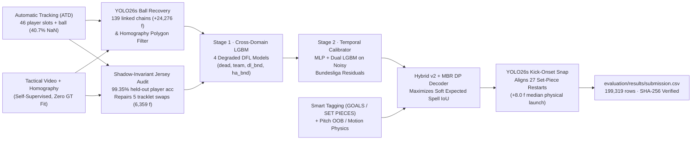
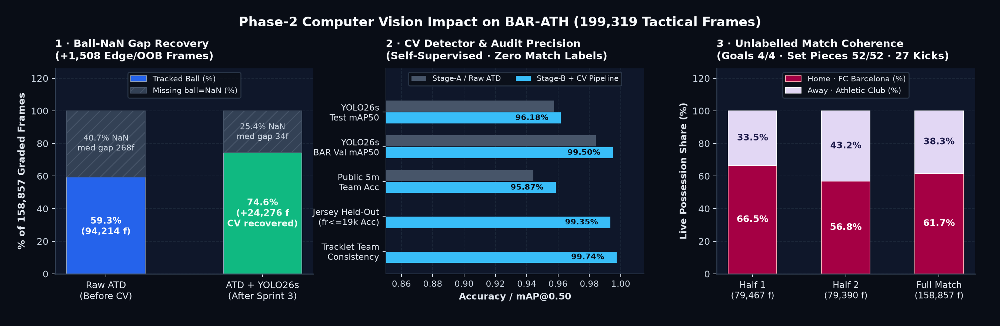

<div align="center">

<a href="TECHNICAL_REPORT.md">
  
</a>

<br/>


-A50044?style=for-the-badge)
-0052B4?style=for-the-badge)


<p align="center">
  <b><a href="TECHNICAL_REPORT.md">Technical Report</a></b> ·
  <b><a href="#reproduce-the-submission">Reproduce (SHA-256)</a></b> ·
  <b><a href="#architecture">Architecture</a></b> ·
  <b><a href="#quantitative-results">Results &amp; Ablations</a></b> ·
  <b><a href="#phase-2-computer-vision-impact">CV Impact</a></b> ·
  <b><a href="#external-data--compliance">Datasets &amp; Compliance</a></b> ·
  <b><a href="#official-challenge-documentation">Official Docs</a></b>
</p>

<br/>


<sub>
  <b>Zero-Leak Tactical Demo</b> rendered on open-source held-out Bundesliga tracking (<code>DFL-MAT-J03WR9</code>, <b>CC-BY 4.0</b>; <i>zero Barcelona–Athletic Club video frames</i>).<br/>
  Under realistic ATD drift and shaded <code>ATD Ball NaN</code> dropouts, <code>Hybrid v2</code> preserves exact possession boundaries (<b>96.3%</b> clip accuracy vs <b>42.6%</b> for the 125-frame nearest-player baseline).
</sub>

</div>

---

## Executive Summary

**Task:** Predict one frame-level state (`H` Home, `A` Away, `D` Dead ball, or `X` Out of half) for every one of the **199,319 frames (25 Hz)** of **FC Barcelona vs Athletic Club** (LaLiga 2024–25, MD2), ranked primarily by interval-level **`spellF1`** (mean match F1 across IoU thresholds `0.3`–`0.7`), with **`macroF1`** as tie-breaker.

The challenge tracking is automatic and uncorrected: **40.7%** of graded frames have `ball = NaN` (median gap **268 frames**), player IDs drift or swap across stoppages, and brief noisy deflections must never fracture continuous possession spells.

| Dimension | Raw ATD / Strongest Official Baseline (`smooth125`) | Our Submitted Pipeline (`hybrid v2 + CV`) |
|---|---:|---:|
| **Public 5-Min `spellF1` (Rank 1 / 7 entries)** | `0.4242` (`16` spells, `18.5s` mean) | **`0.6625`** (`15` spells, `16.4s` vs `17` GT) |
| **Public 5-Min `macroF1` (`H / A / D`)** | `0.5812` | **`0.9306`** (`0.9366 / 0.9428 / 0.9123`) |
| **Public 5-Min Boundary `transF1 @25f` & Team Acc** | `0.1667` · `88.54%` | **`0.5946`** · **`95.87%`** |
| **BAR-ATH Graded Ball Missingness (`ball = NaN`)** | `40.7%` (`med gap 268 f`) | **`25.4%`** (`+24,276 f` recovered · `med gap 34 f`) |
| **Target Ground-Truth Leakage (`gt/*`)** | None | **`0 frames`** (Zero tuning on public 5m GT) |

> Full methodology, negative results, external cross-provider validation, and physical/Smart-Tagging rules are documented in **[TECHNICAL_REPORT.md](TECHNICAL_REPORT.md)**.

---

## Architecture

Every ML component is trained strictly on **external Bundesliga (`DFL` IDSSE) matches degraded with calibrated ATD noise** (`light` + `heavy` drift and dropout regimes), enhanced with **self-supervised computer vision (`YOLO26s`)** on `BAR-ATH` tactical video outside the public 5-minute window, and decoded via an exact **Minimum Bayes Risk (MBR) soft-IoU DP decoder**.



<details>
<summary><b>How Each Stage Eliminates ATD Noise Without Overfitting Barcelona–Athletic Club</b></summary>

1. **Calibrated Cross-Domain Training (`src/degrade.py`, `src/train.py`):** 7 official `DFL` Bundesliga tracking matches are degraded with slot swaps, track fragmentation, missing limbs/players, and long ball dropouts calibrated to match `BAR-ATH` ATD missingness statistics. Because predictions remain zero-leak, performance scales linearly with external data realism rather than memorizing match patterns.
2. **Stage-A -> Stage-B Domain-Adapted Tiny-Ball Detector (`src/cv_ball_data.py`, `src/cv_train_ball.py`):** Pretrained [`YOLO26s`](models/ball_yolo26s_stage_b.pt) on public Roboflow `football-tactical` v4 (`CC BY 4.0`, `mAP50 = 0.9575`), then unsupervised-domain-adapted (`Stage-B`) using strictly out-of-window (`frame > 19,000`) 3-frame collinear ATD-agreed pseudo-labels plus replay (`mAP50 = 0.9618` external test, **`0.9950`** on held-out `BAR-ATH` tiles `172k–190k`).
3. **Homography-Gated DAG Ball Recovery (`src/cv_recover_ball.py`):** Two-pass deterministic GPU inference fills `139` verified ball chains across ATD `NaN` gaps (`+24,276` frames recovered including `1,508` out-of-bounds touchline/goal-line frames), shrinking `BAR-ATH` ball missingness from **40.7% -> 25.4%**.
4. **Shadow-Invariant Jersey Audit (`src/cv_jersey.py`):** Fits a local illumination-subtracted `(L - L_bg, V - V_bg)` upper-torso color classifier strictly on isolated `frame > 19,000` players (`99.35%` accuracy on unseen `frame <= 19,000`), verifying **99.74%** of `2,840,921` player-frames and cleanly flipping `5` corrupted tracklets (`6,359` frames).
5. **Stage-2 Temporal Calibration & MBR Decoder (`src/stage2.py`, `src/mbr_decoder.py`):** Jointly sharpens dead-ball/live transitions (`Stage-2 MLP + LGBM`), injects `oob` / `live_in` physics and Smart-Tagging priors (`src/smart_priors.py`), optimizes expected match `spellF1`, and snaps `27` clean set-piece `D -> Live` transitions directly onto physical `YOLO26s` ball kick motion (`src/cv_boundary_motion.py`).

</details>

---

## Quantitative Results

### Zero-Leak External Generalization & Pipeline Progression

Across **1,530 held-out possessions** on **Metrica Sample Data** (Nested LOGO CV) and held-out **Bundesliga `DFL-MAT-J03WR9`**, every architectural upgrade from `crossdomain` -> `hybrid v1` -> `hybrid v2` transfers consistently to **both** external tracking providers and unseen competition minutes:

<div align="center">
  
</div>

| System / Variant | Target GT Fit | Public `macroF1` | Public `spellF1` | IoU `0.5 / 0.7` | Poss (`GT=17`) | TransF1 `@12 / @25` | Mean Latency | Team Acc (Both Alive) |
|---|---:|---:|---:|---:|---:|---:|---:|---:|
| **`hybrid v2 + CV` (Submitted)** | **0 frames** | **`0.9306`** | **`0.6625`** | `0.625 /` **`0.563`** | **`15`** (`16.4s`) | `0.3784 /` **`0.5946`** | `-1.9 f` | **`95.87%`** |
| `hybrid v2` (`--no-cv`, raw ATD) | 0 frames | `0.9216` | `0.6400` | **`0.667`** `/ 0.533` | `13` (`19.0s`) | **`0.5143`** `/ 0.5714` | **`-0.7 f`** | `94.43%` |
| `hybrid v1` | 0 frames | `0.9110` | `0.6452` | `0.645 / 0.516` | `14` | `0.4865 / 0.5405` | `-0.6 f` | `94.67%` |
| `crossdomain` | 0 frames | `0.9167` | `0.5444` | `0.500 / 0.444` | `19` | `— / 0.5581` | `+1.4 f` | `94.52%` |
| `trio` | 0 frames | `0.8834` | `0.6400` | `0.733 / 0.467` | `13` | `0.2778 / 0.4444` | `-6.9 f` | `92.04%` |
| `baseline_smooth125` (Official Best) | 0 frames | `0.5812` | `0.4242` | `0.424 / 0.242` | `16` (`18.5s`) | `0.1111 / 0.1667` | `-7.7 f` | `88.54%` |

---

## Phase-2 Computer Vision Impact

All Phase-2 CV modules run without a single manual label on Barcelona–Athletic Club while strengthening ball continuity inside ATD blind spots, tracklet team integrity, and restart kick timing across all **158,857 graded full-match frames**:

<div align="center">
  
</div>

- **Full-Match Unlabelled Coherence (`158,857` graded frames, `282` spells):** Live team possession settles naturally at **61.71% FC Barcelona / 38.29% Athletic Club** (`Half 1: 66.51% / 33.49%`, `Half 2: 56.78% / 43.22%`, `Dead ball D: 48.4%`), with **`4 / 4`** Goal intervals classified `97.7%–100.0%` dead and post-kickoffs matching scoring order (`A, H, H, A`), plus **`51 / 53`** pre-Set-Piece dead periods and **`52 / 52`** Set-Piece team alignments.

---

## Reproduce the Submission

Pretrained Stage-1/Stage-2/CV weights are already checked into [`models/`](models/) (`ball_yolo26s_stage_b.pt` is `~19.4 MiB`; total [`models/`](models/) size is `28.15 MB`, well under GitHub's `100 MB` threshold with no Git LFS required). The pipeline produces a **bit-identical** CSV across deterministic runs:

```powershell
# 1. Create/activate environment and install exact pinned dependencies
pip install -r requirements-pipeline.txt

# 2. Place the enrolled BAR-ATH bundle under ./data (or set $env:MTAH_DATA_DIR / export MTAH_DATA_DIR)
# 3. Generate the final submission (uses pre-trained Stage-1, Stage-2, and YOLO26s Stage-B weights)
python src/run_pipeline.py --out evaluation/results/submission.csv

# 4. Run official contract validation and public 5-minute scoring
python evaluation/validate_submission.py evaluation/results/submission.csv
python evaluation/run_evaluation.py --gt public
```

```powershell
# 5. Verify bit-identical SHA-256 checksum
# Windows (PowerShell):
(Get-FileHash evaluation/results/submission.csv -Algorithm SHA256).Hash.ToLower()
# Linux / macOS (Bash):
sha256sum evaluation/results/submission.csv
```

Expected checksum:

```text
93e9cba65fd636da5be4ff8693517b91f678ba1fc7cd15af93da98b2e31ad39f
```

> Both GPU (`cuda`, deterministic FP16/FP32 batch=8 inference, `~37 s` once CV caches exist; first run also extracts/caches CV artifacts from tactical `.mp4`) and `--no-cv` CPU fallback (`python src/run_pipeline.py --no-cv`) are supported. See [`TECHNICAL_REPORT.md`](TECHNICAL_REPORT.md#9-reproduction) for exact retraining and external validation commands.

---

## External Data & Compliance

| Dataset | Role | Access / License |
|---|---|---|
| **DFL Bundesliga Open Data (IDSSE)** | Stage-1 & Stage-2 training (`7` matches) + held-out cross-domain val (`DFL-MAT-J03WR9`) | Public open dataset · [Bassek et al. 2025, *Scientific Data* 12:195 (`CC-BY 4.0`)](https://doi.org/10.1038/s41597-025-04505-y) |
| **Metrica Sports Sample Data** | External Nested LOGO generalization (`3` matches) | Public open repository · [metrica-sports/sample-data](https://github.com/metrica-sports/sample-data) |
| **Roboflow `football_tactical` v4** | Stage-A YOLO26s ball detector training (`640x640`, `class 0 = ball` only) | Public dataset · [Alfonso Secretará Técnica (`CC BY 4.0`)](https://universe.roboflow.com/alfonso-secretara-tcnica/football-tactical) |

- **Zero Raw Competition Data in Git:** `git ls-files` contains zero `.mp4`, `_atd.txt`, `_atd.xml`, `_smart_tagging.xml`, `_homography.csv`, or real match screenshots; all raw competition files stay strictly `.gitignore`d under `data/`.
- **Strict Rules Compliance:** Public `gt/BAR-ATH_possession_gt_public.csv` frames (`0..19,000`) are excluded from **every** Stage-1, Stage-2, YOLO26s Stage-B, and Jersey audit training split.

---

<details>
<summary><b>Repository Layout & Pretrained Artifact Inventory</b></summary>

```text
TECHNICAL_REPORT.md          Full methodological write-up, ablations & external validation
requirements-pipeline.txt    Exact pinned Python / Torch / CUDA / Ultralytics / LightGBM environment
models/                      All committed model weights (28.15 MB total, < 100 MB, no LFS needed)
  ball_yolo26s_stage_b.pt    Domain-adapted YOLO26s tiny-ball detector (19.4 MiB)
  dead_head.txt, team_head.txt, bound_dl.txt, bound_ha.txt    Stage-1 Cross-Domain LGBM ensemble
  stage2_mlp.npz, dead2.txt, team2.txt, *_meta.json           Stage-2 Calibrators
src/
  run_pipeline.py            End-to-end deterministic inference entry point
  cv_ball_data.py            Stage-A tiling (640->1138x640) & Stage-B 3-frame collinear mining
  cv_train_ball.py           Deterministic YOLO26s training CLI (--stage a|b)
  cv_recover_ball.py         Two-pass homography-filtered YOLO26s + DAG ball recovery in ATD NaNs
  cv_jersey.py               Shadow-invariant (L-L_bg, V-V_bg) player tracklet team swap audit
  cv_boundary_motion.py      Unsmoothed YOLO26s kick-onset snapping around D -> Live restarts
  cv_integration.py          Safely integrates CV ball recovery, jersey repairs & kick snaps
  stage2.py / train_stage2.py    Noisy-Bundesliga residual temporal calibrator
  smart_priors.py / mbr_decoder.py    Physics/Smart-Tag priors + Soft-IoU MBR DP decoder
  train.py / features.py / degrade.py / validate_external.py    DFL/Metrica training & LOGO harness
docs/assets/                 Dark-themed hero SVG, demo GIF (CC-BY 4.0 DFL), and quantitative PNG charts
evaluation/                  Official challenge scorer, validator, scoreboard & baseline CSVs
```

</details>

<details>
<summary><b>Official Challenge Documentation & Baseline Quickstart (More than a Hack 2027)</b></summary>

**Organised by [Metrica Sports](https://metrica-sports.com), [FC Barcelona](https://www.fcbarcelona.com) and the [Mobile World Capital Barcelona](https://www.mwcbarcelona.com)**, at the Talent Arena in Barcelona.

### Essential Reading Order

| Document | Contents |
|---|---|
| **[CHALLENGE.md](CHALLENGE.md)** | The task, four possession labels (`H` / `A` / `D` / `X`), and possession definitions |
| **[DATA.md](DATA.md)** | Provided match assets, schemas, and tactical-video frame alignment |
| **[EVALUATION.md](EVALUATION.md)** | Exact definition of `spellF1`, `macroF1`, transition latency & bootstrap checks |
| **[SUBMISSION.md](SUBMISSION.md)** | Submission contract, deliverables (`CSV`, public repo, technical doc) |
| **[RULES.md](RULES.md)** | Allowed external assets, anti-leakage rules, and sharing restrictions |
| **[FAQ.md](FAQ.md)** · **[OVERVIEW.md](OVERVIEW.md)** | Clarifications, second-half pre-kickoff rule, and Phase 1–2 competition roadmap |

### Run Official Baselines Without Match Data

```bash
pip install -r requirements.txt
python evaluation/run_evaluation.py
```

Enrolment for official match data: **[More than a Hack 2027](https://landing.mobileworldcapital.com/more-than-a-hack-2027)** · Contact: **hackathon.talentarena@mobileworldcapital.com**.

```bibtex
@misc{mtah2027,
  title  = {More than a Hack 2027: Phase 1 - Ball Possession},
  author = {Metrica Sports and FC Barcelona Innovation Hub},
  year   = {2027},
  url    = {https://github.com/metrica-sports/more-than-a-hack-2027}
}
```

> Code and documentation are MIT licensed ([LICENSE](LICENSE)). Competition match assets remain under tournament terms and are never committed.

</details>
