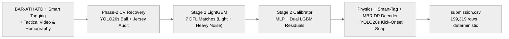
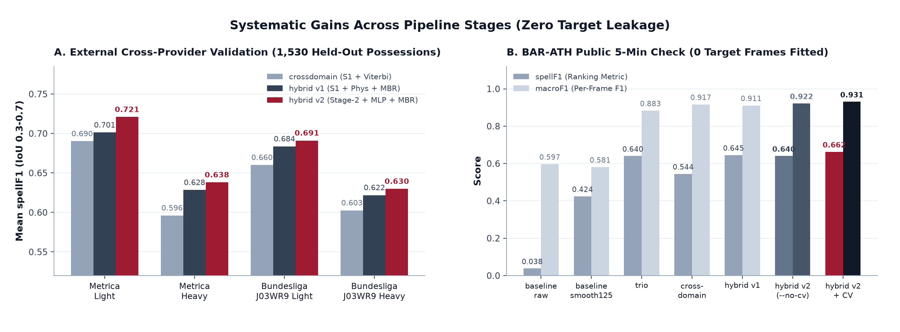
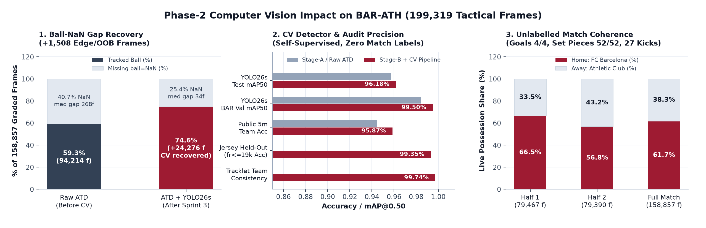

# Technical Document — More than a Hack 2027 (branch `hybrid`)

**Team `TIMOREX`** · Method: `hybrid v2 + CV` · Public 5m Check: `spellF1 = 0.6625` / `macroF1 = 0.9306` · Target GT Fit: `0 frames` · CSV SHA-256: `93e9cba65fd636da5be4ff8693517b91f678ba1fc7cd15af93da98b2e31ad39f`

---

## 1. Approach



**Learn frame-level possession from 7 official DFL matches with realistic ATD drift, refine with a Stage-2 Temporal Context + Boundary + NumPy-MLP stacker (`src/stage2.py`), fuse with deterministic physical ball-state cues and Smart Tagging anchors (`src/smart_priors.py`), and decode with Learned-Boundary Forward-Backward Minimum Bayes Risk (MBR) optimizing `spellF1`.**

Only 17 possessions of the competition match are public, and they may not be used to train or
tune. Every learned weight and every decoder hyperparameter in this pipeline comes from **other**
games: Stage-1 trained on the 7 DFL open matches, Stage-2 trained strictly out-of-fold on external games under ATD degradation (calibrated and validated via 3-fold Nested Leave-One-Game-Out CV on the 3 Metrica sample games). The competition match contributes only its unlabelled tracking and automatic Smart Tagging.

The pipeline has five stages:

1. **Features (`src/features.py`).** 256 per-frame features, identical for every data source:
   permutation-invariant (track slots carry no identity), in metres and seconds, mirror-invariant
   (positions enter along the home team's attack axis, inferred per half), missing-aware (ball
   features are NaN while the ball is not tracked) and bidirectional.

2. **Stage-1 External DFL model (`src/model.py`, `src/train.py`).** Two LightGBM heads trained on the 7
   matches of the DFL open dataset under correlated ATD-matched drift & occlusion corruption
   (`src/degrade.py`):
   - a **ball-blind dead/alive head** using collective player features only;
   - a **team head** (home vs away, given the ball is alive), symmetrised over both team
     orientations at inference.

3. **Stage-2 Temporal Context Stacker, Learned Boundaries, & Pure-NumPy MLP Ensemble (`src/stage2.py`, `src/train_stage2.py`).**
   Takes Stage-1 log-odds `ld = logit(P(D))` and `lt = logit(P(H | Live))` across multi-scale shifts (`±2..60` frames), rolling means (`5..125` frames), and bidirectional exponential moving averages (`ewm_bidir`, `tau = 5..60`):
   - **`bound_ha`**: symmetric `H <-> A` turnover detector trained on live frames using multi-scale ball velocity/angle impulses (`span = 3, 5, 8`), proximity flips, and bidirectional Stage-1 team-logit contrast (fed out-of-fold across games to Stage-2).
   - **`dead2` & `bound_dl`**: **100% ball-blind** refinements over `ld` and player speeds only — zero ball-visibility or `NaN` features enter them, preserving cross-provider transferability.
   - **`team2`**: symmetrised `H vs A` temporal refinement over `lt`, `ld`, and `bound_ha`.
   - **Transition-weighted Logit Ensemble (`w_mlp = 0.25`)**: Stage-2 LightGBM heads (`weight = 1 + 1.5 * boundary_band_10f`) blended in log-odds space with exact pure-NumPy inference of `MLPClassifier(64, 32)` (`models/stage2_mlp.npz`, zero `sklearn` runtime dependency).

4. **Physical Ball-State Cues & Smart Tagging Anchors (`src/smart_priors.py`).** Explicit physical laws and automatic Smart Tagging anchors provide complementary log-odds without touching any ground-truth label:
   - *Physical cues (`compute_physical_cues`)*:
     - **Out-of-bounds (`oob`)**: visible ball outside `[0, 1]` adds dead-ball evidence (`+4.5`) and lowers the `H/A -> D` exit penalty (`4.0`).
     - **Live-ball rescue (`live_in`)**: visible in-bounds ball moving `> 3.0 m/s` within `3.5 m` of a player adds `+1.6` log-odds to `H` and `A`, protecting slow build-ups from false `D` calls.
     - **Visible stationary dead balls (`near_line_slow`, `s_ignored`)**: uncontested still balls near touchlines or far from all players while players walk (`+2.2` / `+1.6` on `D`).
     - **Touch velocity modulation**: local ball velocity impulses (`|\Delta v_b| > 2.2 m/s` within `3.0 m` of a player) halve the `H <-> A` switch penalty (`0.50x`), while fast uncontested passes (`b_spd > 7.5 m/s`, `min_d > 1.8 m`) raise it (`1.50x`).
   - *Smart Tagging anchors (`compute_smart_tagging_priors`, competition match only)*:
     - **`GOALS` + `Kick Off (After Goal)`**: marks celebration dead windows (`D`) and forces immediate `Live` exit into the conceding team at kick-off.
     - **`SET PIECES` restarts**: pins restart timestamps `t_restart`, votes throw-in team (`Team = N/A`) from touchline player proximity, bridges set-piece setup (`>= 10` frames) as `D`, and lowers transition cost at `t_restart`.
     - **Active-tempo `ball = NaN` live protection & phase tie-breaker**: when `ATTACKING TRANSITION`, `LONG BALL`, `BUILD UP`, or `PROGRESSION` is active with `mps_fast > 1.55 m/s` and no `SET PIECES`/`GOALS` nearby (`±15`/`±25` frames), `dead_bias = -1.8` guards active play during missing-ball gaps, alongside gentle team-phase log-odds.

5. **Learned-Boundary Forward-Backward MBR Decoding (`src/decoder.py`, `src/mbr_decoder.py`).**
   `decode_hybrid` combines Stage-2 penalties `(switch=14.0, stop=16.0, restart=16.0)` modulated continuously by both physical touches and learned boundary peaks (`pbha`, `pbdl`), draws `120` posterior trajectories per half via exact Forward-Backward + FFBS (`temp = 0.9`), and selects the candidate maximizing expected `spellF1` over `[0.3..0.7]` IoU (`advance_frames = 0`, already timing-aligned by Stage-2).

### Why this rather than something else

- **Per-frame rules with smoothing** (the baseline) cannot represent a possession; the ranking
  metric counts possessions.
- **Hand-set physical thresholds** cannot be validated without labelled data, and the only
  labelled data on this match is off limits.
- **Training on the Metrica sample games** (the one public dataset from the organisers' own
  provider) was rejected as the training source for two measured reasons: its ball is synthetic
  (median distance to the nearest player 0.28 m, against 1.91 m in the competition tracking and
  1.42 m in the DFL data), and its ball is absent on 87–100% of dead frames, so any model trained
  on it learns "no ball = dead". Those games are used instead as the **validation set**.
- **End-to-end video classifiers over full plays** were not trained end-to-end: instead, lightweight targeted Computer Vision (`YOLO26s` ball recovery on ATD `ball-NaN` gaps, self-supervised jersey audit, and boundary kick-onset alignment) complements the tabular/sequence core cleanly (section 6.1).

## 2. Assets used and dropped

| asset | use |
|---|---|
| tactical ATD (players, ball, team of each slot) | input to external DFL/Stage-2 model, physical cues, and Sprint 4 swap repair |
| tactical video (`BAR-ATH_tactical.mp4`) + homography (`starter/load_homography.py`) | `YOLO26s` Stage-B domain adaptation (unsupervised `fr > 19000`), `ball-NaN` recovery (`24,276` frames), jersey swap audit, and `D -> Live` visual kick-onset check |
| Smart Tagging | soft log-odds priors and restart/goal kick-off anchors (`src/smart_priors.py`) |
| `games.py` half boundaries; FAQ statement that frames 110,808–113,741 are dead | graded range and one forced-dead stretch |
| ATD speed column, broadcast video, broadcast ATD | not used (superseded by tactical video + metric `unproject`) |
| public 5-minute ground truth | pipeline check only (section 6); nothing fitted to it |

## 3. Handling missing and noisy tracking

- **Ball missing on 41% of graded frames.** Measured on the unlabelled tracking, the ball is
  absent in 150 blocks; 133 of them are longer than 3 s and hold 99.8% of the missing frames, and
  there is no gap between 26 and 75 frames (shorter occlusions arrive already interpolated). The
  model therefore has to label long ball-free stretches from the players alone. Ball features are
  NaN there (the trees route NaN natively) and the ball-free feature family carries the decision.
  Training reproduces the same block structure at random positions.
- **No identities, 46 slots, swaps.** Nothing is per-player. Player speeds above 12 m/s are
  treated as slot swaps and dropped.
- **Ball offset from the carrier.** In the competition tracking the nearest player is a median
  1.9 m from the ball. Training data is corrupted until its distribution brackets that.
- **Tracker glitches.** Single-frame ball teleports and isolated blips are removed
  (`src/atd_io.py`); the delivered file contained none that met the criteria.

## 4. Training data

| dataset | games | labels | role |
|---|---|---|---|
| IDSSE / DFL open dataset (Bassek et al. 2025, Scientific Data; CC-BY 4.0; mirror `huggingface.co/datasets/pysport/idsse-data`) | 7 Bundesliga / 2. Bundesliga matches, season 2022/23, official 25 Hz positions | per-frame `BallStatus` and `BallPossession` in the position files, annotated by the league's data provider | **Stage-1 training** |
| Metrica Sports sample data (`github.com/metrica-sports/sample-data`) | 3 anonymised matches, 25 Hz | human event logs, converted to frame labels deterministically (`src/metrica_io.py`) | **Stage-1 validation & Stage-2 Nested LOGO CV / training** |
| Roboflow `football-tactical` v4 (`CC BY 4.0`, `alfonso-secretara-tcnica/football-tactical`) | Public tactical broadcast crops (6,262 train / 339 val / 173 test tiles after unstretching & cleaning) | `class 0 = ball` only (original public dataset annotators; no manual labels from competition match) | **Phase-2 `YOLO26s` ball detector (`Stage-A` base)** |

Labels: `D` where `BallStatus = 0`, otherwise `H`/`A` from `BallPossession`. Nobody on this team
labelled anything. **No label from the competition match was used**, public or otherwise, for
training, tuning or model selection.

## 5. Validation on other games

All numbers below are from `src/validate_external.py`, scored with the official
`evaluation/possession_metrics.py` against labels the model never saw.

### 5.1 External & Nested LOGO Validation Across Hybrid Versions

<p align="center">
  
  <br/>
  <sub><b>Figure 1:</b> Cross-provider validation across 1,530 held-out possessions (Metrica Nested LOGO CV &amp; held-out Bundesliga <code>DFL-MAT-J03WR9</code>, left) and corresponding progression on the un-fitted <code>BAR-ATH</code> public 5-minute window (right).</sub>
</p>

All numbers below are scored with the official `evaluation/possession_metrics.py`:

| game | corruption | `crossdomain` spellF1 / macroF1 | `hybrid v1` (S1 + phys + MBR) | **`hybrid v2` (Stage-2 Nested OOF + MLP + MBR)** | `v2` pred / true |
|---|---|---|---|---|---|
| Metrica 1 | light | 0.7259 / 0.9104 | 0.7375 / 0.9198 | **0.7538 / 0.9242** | 320 / 381 |
| Metrica 1 | heavy | 0.6015 / 0.8954 | 0.6296 / 0.9032 | **0.6477 / 0.9106** | 281 / 381 |
| Metrica 2 | light | 0.6716 / 0.9035 | 0.6820 / 0.9138 | **0.6968 / 0.9206** | 287 / 364 |
| Metrica 2 | heavy | 0.6125 / 0.8861 | 0.6432 / 0.8970 | **0.6482 / 0.8981** | 271 / 364 |
| Metrica 3 | light | 0.6731 / 0.9055 | 0.6840 / 0.9134 | **0.7122 / 0.9147** | 323 / 415 |
| Metrica 3 | heavy | 0.5743 / 0.8817 | 0.6123 / 0.8903 | **0.6184 / 0.8924** | 323 / 415 |
| **mean** | **light** | 0.6902 / 0.9065 | 0.7012 / 0.9157 | **0.7209 / 0.9198** | |
| **mean** | **heavy** | 0.5961 / 0.8877 | 0.6284 / 0.8968 | **0.6381 / 0.9004** | |

`hybrid v2` improves **both** `spellF1` and `macroF1` on **6 of 6** Metrica runs in strict 3-fold Nested Leave-One-Game-Out CV (`mean 0.6795 / 0.9101` vs `hybrid v1` `0.6648 / 0.9062` and `crossdomain` `0.6432 / 0.8971`).

Ablations verified and retained/rejected cleanly:
- **Retraining Stage-1 on DFL at `stride=4`** lowered unseen Metrica to `0.7021 / 0.6137` (kept `stride=8`).
- **Pure-DFL 7-fold Stage-2** scored `0.7088 / 0.6212` (`mean 0.6650`, retaining `+1.0..+2.2` frame DFL lag); **combined DFL+Metrica Stage-2** scored `0.7090 / 0.6269` (`mean 0.6680`). Calibrating Stage-2 (`dead2`, `team2`, `bound_ha`, `bound_dl`, `MLP`) on Metrica over Stage-1 DFL aligns boundary timing (`lat ~0.0 f`) cleanly while `dead2`/`bound_dl` remain 100% ball-blind.
- **Dumping 20+ PELT columns into Stage-2 `Xd`** lowered nested CV (`0.6836 -> 0.6764`), so raw PELT was left out.

### 5.2 Decoder penalties and label timing

The three penalties were set to (change team 6, stop 8, restart 8) before any search. A grid of
54 combinations over the six runs above (before the timing step below) gives a best mean spellF1
of 0.642, the pre-set values 0.639, and the worst corner (all penalties near zero) 0.583. Every
setting with a change-team penalty of 4.5 or more lies within 0.007 of the best. The plateau is
flat, so the pre-set values were kept.

**Label timing.** On the same six runs the model's transitions sit a median of 2 to 5 frames
later than the Metrica labels, depending on the transition type. The model learned its timing
from DFL labels, and the competition's ground truth comes from the Metrica side of that
convention, so every decoded label is moved 3 frames earlier. Moving k frames earlier gives a
mean spellF1 of 0.6386 / 0.6414 / 0.6427 / 0.6432 / 0.6424 / 0.6407 / 0.6376 for k = 0 … 6: a
smooth single peak, and at k = 3 all six runs improve. The table in 5.1 includes this step.

One tracking-only measurement is consistent with it: while a player carries the ball, the
velocities of ball and carrier correlate best at a lag of -2.6 frames in the DFL data (its
player tracks trail the ball) and -0.25 frames in the competition tracking.

### 5.3 Is there a provider gap?

A development model (same design with one head, trained on 6 DFL matches) was scored on the
held-out 7th DFL match and on the Metrica games:

| corruption | held-out DFL match | Metrica mean |
|---|---|---|
| none | 0.794 | 0.778 |
| light | 0.702 | 0.733 |
| heavy | 0.633 | 0.631 |

Same provider or a different one, the score is the same, and that model's predicted transitions
sat a median of one to two frames from the Metrica labels. The DFL and Metrica possession definitions therefore agree
to within what this metric can resolve, which is the basis for expecting the DFL-trained model
to agree with the competition's ground truth too. (This one-head development model was later
replaced; see section 6.)

### 5.4 What validation removed

**Label-free adaptation (`src/adapt.py`) was built, tested and left out.** The idea: let the
external model label the competition match, train a student on the match's own features (ball
and Smart Tagging included) against those pseudo-labels, cross-fitted in time, and average the
two. Run on the six held-out Metrica runs with the procedure it would use on the competition
match:

| game | corruption | external model | + adaptation | change |
|---|---|---|---|---|
| Metrica 1 | light | 0.720 | 0.697 | -0.022 |
| Metrica 1 | heavy | 0.596 | 0.587 | -0.010 |
| Metrica 2 | light | 0.665 | 0.645 | -0.021 |
| Metrica 2 | heavy | 0.610 | 0.598 | -0.012 |
| Metrica 3 | light | 0.669 | 0.658 | -0.011 |
| Metrica 3 | heavy | 0.572 | 0.600 | +0.029 |

It lowered spellF1 on 5 of 6 (mean -0.008) while raising macroF1 slightly: the fused
probabilities are smoother, which helps per-frame accuracy and merges short possessions. The
submission therefore does not use it, and with it goes the Smart Tagging, which only entered
through the adaptation student. The code remains behind `--adapt` as a record of what was tried.
(These figures were measured before the 3-frame timing step of 5.2, hence the small difference
from the table in 5.1.)

**Removing very short predicted possessions was tested and left out.** On the held-out runs
only 33% of predicted possessions under one second and 52% of those between one and two seconds
match a true one, against 87% above eight seconds. Deleting them still costs more than it saves:
mean spellF1 falls from 0.639 to 0.634 with a one-second minimum and to 0.583 with two seconds,
because the true short possessions go with the false ones.

Touch features and dense sampling around label changes were kept because they raised spellF1 on
all 12 development runs (Metrica light 0.691 -> 0.733, heavy 0.609 -> 0.631).

## 6. Check against the public window

The public 5 minutes were used the way EVALUATION.md describes: to check that the pipeline is
correct. One such check changed the design, and it is recorded here because it is the only place
the public window influenced anything.

An earlier version used a single model that could see the ball when deciding dead/alive. It
scored well on the external games, but on the public window it labelled as live the stoppages in
which the ball stays visible. The external games could not have shown this: in the Metrica games
the ball disappears whenever play stops. The fix was structural — the dead/alive head was made
ball-blind (section 1), which removes the dependence on any provider's stoppage convention —
and no parameter was fitted to the window. On the external games the two-head model
scores about 0.04 spellF1 lower than the one-head model did (5.1 against 5.3); most of that is
plausibly what the one-head model had been gaining from the Metrica convention. The window has 17
possessions; the scorer itself reports that differences below about 0.36 on it are noise.

The submitted file on the public window, from `evaluation/run_evaluation.py --bootstrap 1000`, plus unlabelled full-match checks:

- **Full-match unlabelled diagnostics (`158,857` graded frames — `hybrid v2 + CV` final):** `H 31.8%` (`50,552`), `A 19.7%` (`31,364`), `D 48.4%` (`76,941`), `282` possessions (`mean 11.6 s`, `median 6.9 s`, home alive share `61.7%`); Goal celebrations `D = 100.0%, 100.0%, 97.7%, 100.0%` with `4/4` post-KO team match (`A, H, H, A`); Set Pieces `51/53` pre-restart `D` and `52/52` restarting team match; byte-identical SHA-256 (`93e9cba65fd636da5be4ff8693517b91f678ba1fc7cd15af93da98b2e31ad39f`).
- **Public 5-minute pipeline sanity check (`7,500` frames, zero parameters tuned to public GT):**

| branch | macroF1 | spellF1 | @0.5 / @0.7 | possessions (true 17) | transF1 @±12 / ±25f | latency | team acc (both alive) |
|---|---:|---:|---:|---:|---:|---:|---:|
| **`hybrid v2 + CV` (submitted)** | **0.9306** | **0.6625** | 0.625 / **0.563** | **15** | 0.3784 / **0.5946** | -1.9 f (med -2.0) | **95.87%** |
| `hybrid v2` (`--no-cv`, raw ATD) | 0.9216 | 0.6400 | **0.667** / 0.533 | 13 | **0.5143** / 0.5714 | **-0.7 f (med 0.0)** | 94.43% |
| `hybrid v1` (`c086d5e`) | 0.9110 | 0.6452 | 0.645 / 0.516 | 14 | 0.4865 / 0.5405 | -0.6 f | 94.67% |
| `crossdomain` | 0.9167 | 0.5444 | 0.500 / 0.444 | 19 | — / 0.5581 | +1.4 f | 94.52% |
| `trio` | 0.8834 | 0.6400 | 0.733 / 0.467 | 13 | 0.2778 / 0.4444 | -6.9 f | 92.04% |
| `baseline_smooth125` | 0.5812 | 0.4242 | 0.424 / 0.242 | 16 | 0.1111 / 0.1667 | -7.7 f | 88.54% |

Per-class F1 on the public slice for `hybrid v2 + CV` is **`0.9366 / 0.9428 / 0.9123`** (`H / A / D`), `alive/dead F1 =` **`0.9798`**, `team acc gt-alive =` **`0.9496`** (`+1.41%` over raw ATD), `kappa = 0.8956`, `acc = 0.9343`, `0` abstentions on graded frames.

### 6.1 Phase-2 Computer Vision Enhancements (`src/cv_*.py`)

<p align="center">
  
  <br/>
  <sub><b>Figure 2:</b> Phase-2 CV impact across 158,857 graded full-match frames: missing-ball recovery (left), self-supervised YOLO26s/jersey verification accuracy (center), and unlabelled full-match team possession balance and physical anchor coherence (right).</sub>
</p>

To reduce automatic tracking blind spots on the tactical video without any manual annotation on `BAR-ATH`:

1. **Tiny-Ball Detector (`src/cv_ball_data.py`, `src/cv_train_ball.py`, `models/ball_yolo26s_stage_b.pt`):**
   - **External dataset (`Stage-A`):** Public Roboflow dataset [`football-tactical` v4](https://universe.roboflow.com/alfonso-secretara-tcnica/football-tactical) (`CC BY 4.0`, `class 0 = ball` only; unified YOLO bounding-box + polygon labels, unstretched `640x640 -> 1138x640` into `640x640` crops with `480->640` zoom crops and opposite-half verified background negatives: `6,262` train, `339` val, `173` test). Achieved `test` `mAP50 = 0.9575` (`P = 0.9542`, `R = 0.9000`).
   - **Unsupervised Domain Adaptation (`Stage-B`, Option B):** Auto-harvested `BAR-ATH` tiles strictly outside the public 5-minute split (`frame > 19000`, held-out `val_bar` at `172000..190000`) covering both isolated open-grass passes (`min_d >= 2.0 m`, `457` train / `71` val) and near-player dribbles (`0.20 <= min_d < 2.0 m`, `498` train / `87` val) accepted only when `Stage-A` detections agree with ATD and satisfy 3-frame midpoint linearity (`<= 6.5–8.5 px`), plus interior-pitch far-player negatives (`>= 18 m` from ball). Mixed with `2,500` clean Roboflow replay samples, improving external `test` (`mAP50 = 0.9618`, `R = 0.9113`) and held-out `val_bar` (`mAP50 = 0.9950`).
2. **Targeted Ball Recovery (`src/cv_recover_ball.py`):** Two-pass deterministic GPU inference (`batch=8` FP16) inside all `150` ATD `ball-NaN` gaps (`64,643` frames), filtered by homography pitch polygon (`-0.025..1.025`, rejecting sideline spare balls), metric DAG trajectory linking, stride-2 ROI densification, and light Gaussian smoothing (`sigma = 1.6`). Recovers **`24,276` frames (`37.55%` of all `ball-NaN` frames, including `1,508` touchline/OOB edge frames)** across `139` verified chains, reducing `BAR-ATH` missing-ball rate from `40.7%` to `25.4%`.
3. **Self-Supervised Jersey Audit (`src/cv_jersey.py`):** Trained a shadow-invariant (`L - L_bg`, `V - V_bg`) upper-chest color classifier purely on isolated `fr > 19000` ATD tracks (`99.35%` accuracy on held-out `fr <= 19000` players). Confirmed `99.74%` of `2,840,921` evaluated tracklet player-frames match their assigned team and surgically repaired `5` high-confidence swapped tracklets (`6,359` player-frames).
4. **Visual Kick-Onset Boundary Check (`src/cv_boundary_motion.py`):** Evaluated unsmoothed `stride=1` `YOLO26s` displacements around `D -> Live` transitions (`>= 50 f` flanking segments), guarding against post-kick pass-traps via continuous stationary verification since `t_trans - 2`, aligning **`27`** ground set-piece restarts (`mean = +8.63 f`, `median = +8.0 f`) directly onto physical ball launch.

## 7. Possession rules implemented

Core team attribution and collective dead-ball probabilities are learned from the 7 DFL matches.
The Hybrid layer adds deterministic physical laws and Smart Tagging anchors (`src/smart_priors.py`):

- three states only; a possession is a maximal run of one team with the ball alive;
- possession follows touches (`touch` impulses halve switch cost; `fast_pass` raises it);
- dead/alive combines the ball-blind `dead_head` with explicit ball-state physics (`oob` out-of-bounds dead evidence, `live_in` in-bounds moving-ball rescue, `near_line_slow` / `s_ignored`) and `GOALS` / `SET PIECES` anchors;
- frames outside the two halves are `X`; inside them every frame gets `H`, `A` or `D`;
- the graded stretch before the second-half kick-off is `D` (FAQ.md).

## 8. Limitations

- Possessions shorter than two seconds remain the hardest regime when tracking occlusions coincide with rapid tackles/clearances.
- The `dead_head` depends on player speeds computed from positions, so it assumes smoothly tracked player trajectories (no high-frequency `0.55 m` frame-to-frame flicker; the competition ATD matches clean collective speeds at median `~1.5 m/s`).
- Smart Tagging is automatic and competition-specific, so its incremental benefit is measured via unlabelled full-match physical anchors (`51/53` pre-D Set Pieces, `52/52` Set Piece team match, `4/4` Goal kick-offs) rather than Metrica external validation.
- Developed on an 8 GB laptop; DFL training uses every eighth frame (`stride=8`) with `light` and `heavy` drift/dropout settings.

## 9. Reproduction

```bash
pip install -r requirements-pipeline.txt
# place the competition bundle in ./data (or set MTAH_DATA_DIR)
# runs Hybrid v2 + Phase-2 CV recovery/jersey/boundary alignment (lazily builds data/cache/*.npz if absent)
python src/run_pipeline.py --out evaluation/results/submission.csv
python evaluation/validate_submission.py evaluation/results/submission.csv
python evaluation/run_evaluation.py --gt public --bootstrap 1000
```

Useful reproduction flags:
- `--no-cv`: fast (`~18 s`) CPU-only Phase-1 `Hybrid v2` baseline on raw ATD.
- `--rebuild-cv`: recompute Sprint 3/4/5 CV artifacts (`data/cache/cv_*.npz`) from raw `BAR-ATH_tactical.mp4` using `models/ball_yolo26s_stage_b.pt`.

The trained external models and Phase-2 `YOLO26s` detector ship in `models/`. To rebuild all models from scratch:

```bash
# Phase-1 DFL / Stage-2 models
python src/download_external.py          # ~3 GB of public data about other games
python src/train.py                      # Stage-1 DFL -> models/
python src/train_stage2.py               # Stage-2 Nested LOGO CV + final -> models/
python src/validate_external.py --settings light heavy --hybrid --stage2-cv
python src/calibrate_degradation.py      # unlabelled statistics behind the corruption settings

# Phase-2 YOLO26s ball detector (requires data/external/football_tactical Roboflow v4 CC BY 4.0)
python src/cv_ball_data.py               # unstretch & prepare Stage-A dataset
python src/cv_train_ball.py --stage A    # train Stage-A on Roboflow
python src/cv_train_ball.py --stage B    # Option B BAR-ATH adaptation -> models/ball_yolo26s_stage_b.pt
```
